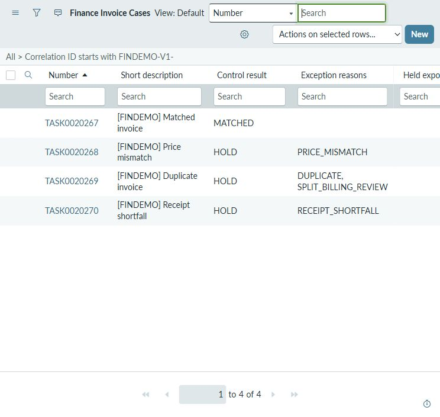
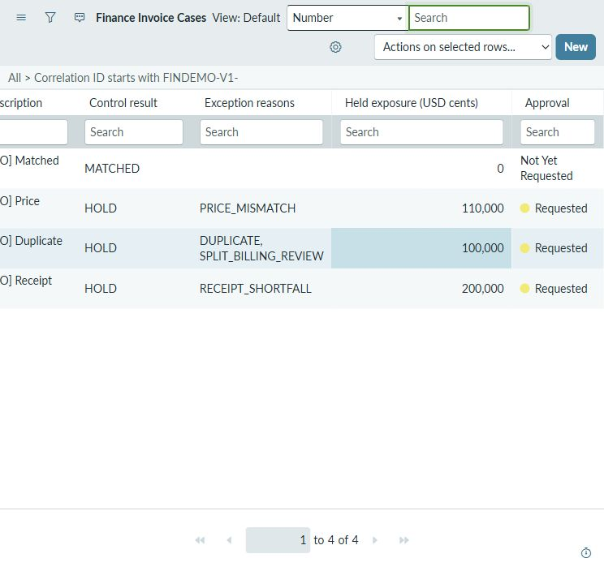

# ServiceNow Finance Invoice Controls

A manufacturing accounts-payable intake demonstration built and verified in a ServiceNow developer instance on November 12, 2026. It flags duplicate invoices, mismatched unit prices, insufficient received quantity, and missing PO snapshots, then creates human-review requests for new held cases.

Published by `servicenowjyo`. All data is synthetic; third-party books and PDFs used for study are listed in `SOURCES.md` and are not redistributed here.

## Observed result

| Synthetic case | Platform record | Result | Held exposure USD | Review |
|---|---|---|---:|---|
| Matched invoice | TASK0020267 | MATCHED | 0 | Not requested |
| Price mismatch | TASK0020268 | HOLD | 1,100 | Requested |
| Duplicate invoice | TASK0020269 | HOLD | 1,000 | Requested |
| Receipt shortfall | TASK0020270 | HOLD | 2,000 | Requested |

The four portfolio cases total **$4,100 held synthetic invoice exposure**. This is not realized savings or a measurement from a real factory. A separate automation test (TASK0020271, $110) is excluded from that four-case total. No payments were executed.





## Run locally

Install Node.js from its official site if necessary. No npm dependencies are needed. In this folder run:

```sh
node tests/policy.test.js
node run-demo.js
```

`evidence/local-results.json` is a local simulation. `evidence/platform-checks.txt` and the screenshots are actual platform evidence. See `STEP_BY_STEP.md` for installation and hands-on practice.

## Files

- `PROMPT.md`: original executed SEED prompt and delivery correction.
- `data/demo.json`: four explicit synthetic input fixtures; no real supplier information.
- `src/policy.js`: dependency-free classification policy.
- `tests/policy.test.js`: boundary and policy checks.
- `servicenow/`: installation, business-rule source, demo loading and platform verification scripts.
- `evidence/`: saved test results and actual screenshots.
- `SOURCES.md`: book and official documentation references.

## Architecture and limits

`u_fin_invoice_case` extends Task, building on the earlier Course Request exercise. Eight custom fields store an invoice/PO JSON snapshot, normalized keys and derived results. A synchronous before rule validates new intake; an after-insert rule creates a requested review for the current PDI administrator when held. Notification processing for approval creation is suppressed. The three initial sample reviews were backfilled by script 04 before automatic review was installed.

This is a single-line, USD demonstration. PO and receipt values are supplied snapshots, not live ERP records or verified supplier master data. Submitted payloads are immutable to preserve intake evidence. The classifier does not release held cases when someone approves; human resolution, correction/replacement handling, and any payment integration remain separate work.

Approval here is a demonstrated review request, not proof of segregation of duties: the administrator is also the reviewer. Role/ACL design, unauthorized-user tests, concurrent duplicate protection using appropriate unique keys, authenticated ERP ingestion, cumulative partial-invoice accounting, audit policies, currency conversion, taxes, credits, tolerances, expiry/escalation and a complete resolution lifecycle are required before production use. No production readiness claim is made. No ACL changes or external finance connections were installed.

Amounts are integer cents and capped at the platform Integer field's positive range. Unsupported currency exposure is excluded from the USD aggregate. Multiple reasons on one case do not multiply its held amount. Duplicate/split-billing checks query earlier persisted cases and are not a concurrency-safe financial ledger.
